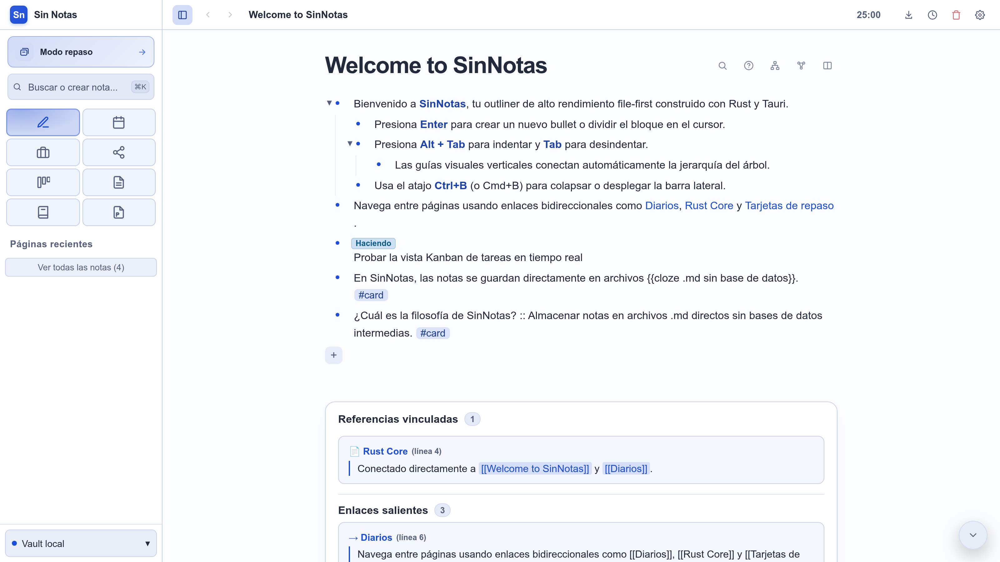
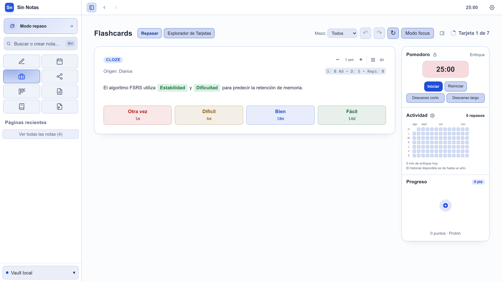
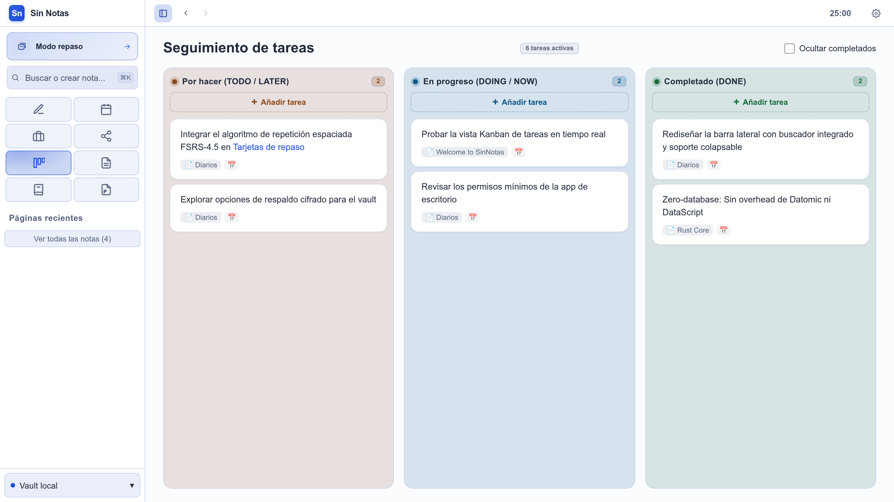
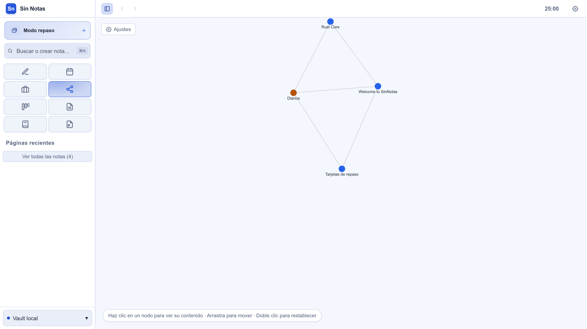
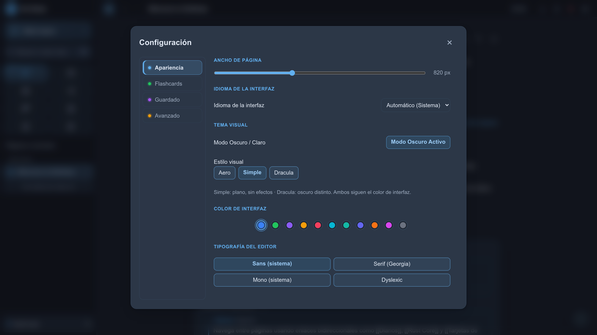

<div align="center">
  
  <h1>SinNotas</h1>
  <p><strong>Piensa en árboles. Recuerda durante años.</strong></p>
  <p>Un outliner local basado en archivos para notas, tareas, PDFs y repaso espaciado.</p>

  <p>
    <a href="https://github.com/wulflo/SinNotas/releases/tag/v0.5.10"></a>
    <a href="https://github.com/wulflo/SinNotas/actions/workflows/ci.yml"></a>
    
    
    
    
    
  </p>

  <p>
    <a href="#-por-qué-sinnotas">Por qué SinNotas</a> ·
    <a href="#-funcionalidades-en-detalle">Funcionalidades</a> ·
    <a href="#-capturas">Capturas</a> ·
    <a href="#-inicio-rápido">Inicio rápido</a> ·
    <a href="#-compilar-desde-el-código">Compilación</a> ·
    <a href="CONTRIBUTING.md">Contribuir</a> ·
    <a href="docs/SinNotas.md">Documentación</a> ·
    <a href="README.md">English</a>
  </p>
</div>

<picture>
  <source media="(prefers-color-scheme: dark)" srcset="docs/screenshots/editor-dark.png">
  
</picture>

> **Tus notas son archivos Markdown.** Sin base de datos, sin formato propietario y sin cuenta en la nube. Apunta SinNotas a una carpeta y tu bóveda está lista.

---

## ✨ ¿Por qué SinNotas?

| Pilar | Qué te da |
| :--- | :--- |
| **🗂️ Archivos, no silos** | Cada página es un archivo Markdown plano dentro de tu bóveda. Léelo, edítalo, búscalo, cópialo o sincronízalo con cualquier herramienta que ya uses. |
| **🧠 Hecho para aprender** | Flashcards FSRS-7, tarjetas cloze, oclusión de imágenes, mazos jerárquicos, modo de enfoque y Pomodoro, en el mismo lugar donde escribes. |
| **🔗 Pensamiento conectado** | Wikilinks, backlinks y un grafo propio de física dirigida convierten notas aisladas en un mapa de ideas. |
| **📄 Un solo espacio** | Outliner, diarios, tareas, lector de PDF, bibliografía y cola de repaso conviven sin plugins ni suscripción. |
| **🔒 Local por defecto** | Sin telemetría, sin cuenta y sin nube incluida. La red solo se usa cuando tú lo pides explícitamente. |
| **🎨 Tuyo para moldear** | Temas claro y oscuro, once colores de acento, estilos visuales, fuentes del sistema y tipografía por área. Disponible en español, inglés y chino, con acceso directo en Ajustes. |

## 🚀 Funcionalidades en detalle

### ✍️ Outliner y escritura

- **Editor jerárquico:** crea y anida bullets, arrástralos para reordenar, selecciona varios bloques y cópialos, córtalos, pégalos o bórralos con su jerarquía. Los hermanos siguen alineados aunque algunos bloques lleven propiedades.
- **Comandos slash:** inserta tablas Markdown, encabezados H1–H6, imágenes, tareas y tarjetas cloze, o aplica colores de texto y fondo.
- **Render Markdown:** negrita, cursiva, subrayado, resaltado y wikilinks, con formato en línea en vivo.
- **Etiquetas en línea:** `#etiqueta` se convierte en una píldora del color de acento del tema.
- **Tablas:** se guardan como Markdown nativo, con edición gráfica, menú contextual de filas/columnas y reordenación arrastrando. El texto cloze `==...==` también funciona dentro de celdas.
- **Búsqueda:** `Ctrl/Cmd + F` busca dentro de la nota actual, resalta coincidencias y permite saltar con `Enter`, `Shift + Enter` o las flechas.
- **Navegación de notas largas:** botones flotantes saltan al inicio o al final y respetan la posición real de scroll tanto en la vista normal como en la dividida.
- **Historial de versiones:** guarda y restaura snapshots de páginas. Viven en `.sinnotas/chronos/`; las carpetas `chronos/` antiguas se migran automáticamente.
- **Exportación:** exporta la página actual como `.txt`.

### 📚 Organización

- **Diarios:** crea notas diarias por fecha y consúltalas desde el calendario.
- **Todas las páginas:** recorre todas las notas de la bóveda y abre su historial de versiones desde el icono del mosaico de navegación.
- **Recientes:** la sidebar muestra hasta 20 notas abiertas recientemente; las fijadas tienen su propia sección.
- **Bóvedas externas:** abre cualquier carpeta Markdown con el selector de directorios y navega sus páginas y subcarpetas.
- **Arranque rápido:** las bóvedas locales mantienen una caché binaria persistente de metadatos (`.sinnotas_cache.bin`), así que solo se analizan las notas nuevas o modificadas al iniciar. Un watcher nativo aplica cambios externos de forma incremental.
- **Sincroniza como quieras:** usa cualquier servicio de sincronización de archivos en el que confíes. SinNotas no impone un proveedor de nube.

### 🧠 Flashcards y repaso espaciado

- **Tipos de tarjeta:** básicas, cloze y oclusión de imagen, programadas con FSRS-7.
- **Modelo FSRS-7:** el planificador oficial de 34 pesos de `ts-fsrs` 6.0.0, con estado de memoria de doble traza (estabilidad más estabilidad rápida) en lugar de una aproximación. La retención deseada, el intervalo máximo, los pasos de aprendizaje/reaprendizaje y los pesos se configuran **por mazo**, y cada mazo programa sus notas con sus propios parámetros.
- **Fase de aprendizaje:** las tarjetas nuevas pasan por pasos fijos cortos (1 min, 10 min) antes de graduarse a repaso FSRS, evitando saltos de intervalo engañosos al inicio. El estado de aprendizaje persiste tras recargar.
- **Herramientas de repaso:** modo de enfoque, Pomodoro, estadísticas, mapa de calor y una visualización del progreso que crece con tu práctica.
- **Recálculo por lotes:** *Ajustes → Recalcular propiedades* aplica los parámetros del mazo de cada nota y cede entre lotes de 40 notas, guardando página por página para que las bóvedas grandes sigan respondiendo.
- **Mazos jerárquicos:** usa `→` en los títulos (por ejemplo `Salud mental → Ansiedad → Tema 1`) para anidar mazos. Seleccionar un mazo padre incluye todas las notas hijas, filtra repasos desde Ajustes y conserva la selección temporal al buscar o paginar.
- **Oclusión de imagen:** dibuja rectángulos, elipses y polígonos, mueve, redimensiona y rota áreas, añade pistas y guarda las transformaciones en los metadatos Markdown del bloque.
- **Imágenes:** PNG, JPG/JPEG, WebP, SVG, GIF y BMP. Las imágenes insertadas se guardan en `assets/` dentro de la bóveda.

### 🔗 Grafo y mapas conceptuales

- Un modelo de física propio de fuerzas dirigidas para explorar relaciones entre páginas.
- Selección con clics alternos, clic en el fondo para limpiar, arrastre de nodos, desplazamiento con el botón central/derecho, zoom con la rueda y doble clic para restablecer.
- Los colores personalizados de nodos se propagan a los vecinos por influencia.
- La interacción sigue viva indefinidamente, incluso después de que se estabilice el layout.
- Consulta [docs/SinNotas.md#grafo-y-mapa-conceptual](docs/SinNotas.md#grafo-y-mapa-conceptual).

### 📄 Documentos, PDFs y bibliografía

- **Biblioteca PDF nativa:** la sección **Documentos** lista y renderiza PDFs con PDFium. Sin PDF.js y sin descargas en tiempo de ejecución.
- **Enlazar, no copiar:** importar un PDF enlaza el archivo original en lugar de duplicarlo. La caducidad opcional mantiene la biblioteca ordenada sin tocar el original. Los documentos enlazados se pueden quitar de la biblioteca sin borrar la fuente; los PDFs guardados en `assets/pdfs/` se pueden borrar de la bóveda.
- **Texto seleccionable:** PDFium extrae segmentos de texto y el lector pinta una capa HTML transparente sobre la página. Copia una selección o insértala como bullet en la nota activa con la propiedad `pdf-source::`.
- **Editor en paralelo:** muestra el PDF y la nota lado a lado con un separador arrastrable, redimensionamiento con teclado, doble clic para restablecer y proporción recordada.
- **Capturas y oclusión:** arrastra un rectángulo sobre una página para guardarlo como PNG en `assets/pdf-captures/`, insértalo en la nota y abre opcionalmente el editor de oclusión.
- **Bibliografía:** gestiona recursos con frontmatter `bib-*`, portadas locales o remotas validadas y notas hijas enlazadas con wikilinks saneados. Busca por DOI, ISBN-10/13 o palabras clave desde el diálogo **Añadir recurso**.
- La biblioteca nativa de PDFium vive en `src-tauri/resources/pdfium/<so>-<arquitectura>/` y se descarga con `scripts/fetch-pdfium.sh`. Los binarios no se versionan.

### ✅ Tareas y planificación

- **Tablero Kanban:** columnas de pendientes, en curso y completadas, arrastrar entre columnas y opción de ocultar tareas completadas.
- **Notas diarias:** añade tareas Kanban al diario y revísalas junto a tus notas.
- **Pomodoro:** duraciones de enfoque y descanso, cadencia de descanso largo, modo contador ascendente, sonido opcional y temporizador compacto en la cabecera.

### 🔐 Privacidad y seguridad

- **Local por defecto:** las notas se quedan en tu bóveda. No hay telemetría ni analítica.
- **Saneado del portapapeles:** el contenido pegado pasa por un pipeline de lista blanca (`src/editor/paste-sanitizer.ts`). Solo sobreviven la indentación, negrita, cursiva, subrayado, tachado, código en línea y listas. Se descartan colores, tamaños de fuente, atributos de enlace, manejadores de eventos y HTML rico.
- **Validación de rutas:** las operaciones de archivo de escritorio se validan en el backend y se limitan a la bóveda activa. `resolve_vault_path` rechaza `..`, rutas absolutas fuera de la raíz, bytes NUL, symlinks que salen de la bóveda y URIs de Android. El selector usa `dialog:allow-open`; no se concede acceso global al sistema de archivos.
- **HTML seguro en repaso:** el Markdown de las tarjetas se escapa y sanea con DOMPurify antes de cualquier `innerHTML`, en escritorio y Android. Las regiones de oclusión se validan y dibujan con `createElementNS`/`setAttribute`, nunca interpolando HTML del usuario.
- **Actualizaciones firmadas:** los paquetes de escritorio se verifican con la firma del actualizador de Tauri antes de instalarse.
- Consulta [PRIVACY_POLICY.md](PRIVACY_POLICY.md) para la política de privacidad completa.

## 📸 Capturas

| Flashcards | Tareas Kanban |
| :---: | :---: |
|  |  |

| Grafo / mapa conceptual | Ajustes de apariencia |
| :---: | :---: |
|  |  |

## ⚡ Inicio rápido

### Requisitos

- **Node.js 24 o superior** (exigido por `engines` de `package.json` y por CI).
- **Rust stable** con `rustup`.
- El WebView de la plataforma y los paquetes del sistema. Las dependencias de Linux están abajo; los prerrequisitos de Windows y Android están en sus secciones de compilación.

<details>
<summary><strong>Dependencias de Linux por distribución</strong></summary>

**CachyOS, Arch Linux, Manjaro, EndeavourOS**

```bash
sudo pacman -S nodejs npm rust
```

**Debian, Ubuntu, Linux Mint, Zorin, Pop!_OS y derivadas**

```bash
sudo apt update
sudo apt install libwebkit2gtk-4.1-dev build-essential curl wget file \
  libxdo-dev libssl-dev libayatana-appindicator3-dev librsvg2-dev
```

> Los repositorios de Debian y Ubuntu suelen traer versiones antiguas de Node y Rust. Instala Node con [nvm](https://github.com/nvm-sh/nvm) o [NodeSource](https://github.com/nodesource/distributions), y Rust con `rustup`.

**Fedora, Nobara, RHEL y derivadas**

```bash
sudo dnf install webkit2gtk4.1-devel openssl-devel curl wget file \
  libappindicator-gtk3-devel librsvg2-devel libxdo-devel nodejs npm
sudo dnf group install "c-development"
```

**openSUSE (Tumbleweed y Leap)**

```bash
sudo zypper up
sudo zypper in webkit2gtk3-devel libopenssl-devel curl wget file \
  libappindicator3-1 librsvg-devel nodejs npm
sudo zypper in -t pattern devel_basis
```

</details>

### Ejecutar el frontend web

```bash
npm install
npm run dev
```

Vite muestra la dirección local en la terminal. Este modo es ideal para trabajar en la UI; las funciones nativas (bóvedas locales, PDFium y actualizador) requieren la app Tauri.

### Ejecutar la app de escritorio

Descarga PDFium una vez para la plataforma actual y arranca Tauri:

```bash
scripts/fetch-pdfium.sh
npm run tauri dev
```

PDFium no se versiona. Los workflows de release descargan la biblioteca correspondiente para Linux, Windows y las dos arquitecturas de macOS antes de empaquetar.

## ⌨️ Atajos del editor

| Atajo | Acción |
| :--- | :--- |
| **Enter** | Divide el bloque en el cursor o crea el siguiente bullet. |
| **Shift + Enter** | Inserta un salto de línea dentro del mismo bloque. |
| **Tab** / **Shift + Tab** | Indenta o desindenta el bloque (o los bullets seleccionados). |
| **Alt + Derecha** / **Alt + Izquierda** | Indenta o desindenta los bullets seleccionados. |
| **Supr** / **Retroceso** | Borra los bullets seleccionados. |
| **Ctrl/Cmd + C** / **X** | Copia o corta los bullets seleccionados cuando no hay texto seleccionado. |
| **Ctrl/Cmd + V** | Pega mediante el saneador. Solo sobrevive el formato Markdown seguro. |
| **Ctrl + Shift + V** | Pega como texto plano. |
| **Ctrl/Cmd + Z** | Deshace. **Ctrl/Cmd + Y** o **Ctrl/Cmd + Shift + Z** rehace. |
| **Ctrl/Cmd + B** | Colapsa o expande la barra lateral. |
| **Ctrl/Cmd + K** | Búsqueda rápida y creación rápida de notas (omnibar). |
| **Ctrl/Cmd + F** | Busca dentro de la nota actual. `Enter` / `Shift + Enter` o las flechas se mueven entre coincidencias; `Escape` cierra la búsqueda. |
| **↑ / ↓** | Mueve el cursor entre bloques cuando está al inicio o al final del bloque actual. |
| **? (botón de ayuda)** | Abre el diálogo de atajos desde la cabecera del editor. |

Los atajos de navegación, búsqueda en nota, seleccionar todo y flashcards se pueden cambiar en **Ajustes → Atajos**. Se rechaza una combinación ya asignada a otra acción (o reservada, como Copiar/Pegar); ↺ restaura el valor por defecto.

## 🧪 Pruebas y benchmarks

```bash
npm test              # suite de pruebas unitarias (Vitest)
npx tsc --noEmit      # comprobación de tipos de TypeScript
npm run build         # build de producción del frontend
```

Pruebas y lints del backend:

```bash
cargo test --manifest-path src-tauri/Cargo.toml --lib
cargo clippy --manifest-path src-tauri/Cargo.toml --all-targets -- -D warnings
```

Banco de pruebas en vivo del grafo (interacción real en el navegador):

```bash
npm run dev
# abre http://localhost:1420/graph-harness.html
```

El resultado aparece en la propia página (se espera `HARNESS PASS`, 17 comprobaciones de gestos: selección, fondo, arrastre, desplazamiento, zoom, colores y estabilidad tras estabilizarse). Tras modificar el grafo, la suite y el banco son obligatorios; las guías y la checklist están en [docs/SinNotas.md#grafo-y-mapa-conceptual](docs/SinNotas.md#grafo-y-mapa-conceptual).

### Benchmark de la caché de metadatos

Genera una bóveda temporal de 5.000 notas y compara un arranque en frío (análisis completo de Markdown) con uno en caliente (barrido de mtime + carga bincode):

```bash
scripts/benchmark-cache.sh
# o: cargo run --release --manifest-path src-tauri/Cargo.toml --example cache_benchmark -- 5000
```

El script imprime los milisegundos en frío/caliente y la aceleración, y borra la bóveda temporal. Consulta [docs/SinNotas.md#cache-de-metadatos-y-watcher](docs/SinNotas.md#cache-de-metadatos-y-watcher) y los resultados registrados en [docs/BENCHMARK-2026-10-29.md](docs/BENCHMARK-2026-10-29.md).

## 🏗️ Compilar desde el código

### AppImage (Linux)

```bash
scripts/fetch-pdfium.sh
npm run tauri -- build --bundles appimage
```

### Snap y Flatpak (Linux)

Ambos paquetes envuelven el mismo binario generado para el `.deb`:

```bash
scripts/package-linux.sh              # compila el .deb y lo extrae
snapcraft pack                        # requiere snapcraft + LXD
flatpak-builder --force-clean --repo=repo flatpak_app \
  packaging/flatpak/com.sinnotas.desktop.yml
```

CI compila ambos en `.github/workflows/package-linux.yml` y adjunta el `.snap` y el `.flatpak` a cada release de GitHub. Se actualizan desde sus tiendas, no desde el actualizador de Tauri: la app detecta `SNAP`/`FLATPAK_ID` y oculta los controles de actualización internos para que el usuario actualice desde la tienda.

### Compilar en Windows

Requisitos:

- [Node.js](https://nodejs.org/) (recomendado con nvm-windows).
- [Rust](https://www.rust-lang.org/tools/install) con `rustup` (añade el target MSVC).
- [Microsoft C++ Build Tools](https://visualstudio.microsoft.com/visual-cpp-build-tools/) con **Desarrollo de escritorio con C++**.
- [WebView2](https://developer.microsoft.com/microsoft-edge/webview2/) (habitualmente presente en Windows 10/11 modernos).
- [Git for Windows](https://gitforwindows.org/) (Git Bash, necesario para `scripts/fetch-pdfium.sh`).

Desde PowerShell o CMD en la raíz del proyecto:

```bash
npm install
bash scripts/fetch-pdfium.sh
npm run tauri build
```

Esto genera el instalador `.msi` y/o `.exe` (NSIS) en `src-tauri/target/release/bundle/`. Para compilar sin instaladores: `npm run tauri build -- --no-bundle`.

Para desarrollo en Windows:

```bash
npm install
bash scripts/fetch-pdfium.sh
npm run tauri dev
```

Las operaciones de archivo de escritorio se validan en el backend y se limitan a la bóveda activa. El selector usa el permiso de Tauri `dialog:allow-open`; no se concede acceso global al sistema de archivos.

### Compilar en macOS

Instala las Command Line Tools de Xcode y Rust con `rustup`, y ejecuta:

```bash
npm install
scripts/fetch-pdfium.sh
npm run tauri build
```

Tauri produce un `.app` y un `.dmg` en `src-tauri/target/release/bundle/`. Para un binario universal, añade ambos targets con `rustup target add aarch64-apple-darwin x86_64-apple-darwin` y compila con `npm run tauri build -- --target universal-apple-darwin`. El workflow de release descarga ambas arquitecturas de PDFium.

### Actualizaciones de escritorio en Linux

Las instalaciones AppImage usan la entrada `linux-x86_64` de `latest.json`. Las instalaciones Debian/Ubuntu usan la entrada firmada `linux-x86_64-deb` desde 0.2.2, así que la app puede descargar e instalar el nuevo `.deb` con `pkexec`/`sudo`. Una instalación `.deb` de 0.2.0/0.2.1 debe instalar 0.2.2 manualmente una vez; las versiones posteriores se actualizan desde la app. Consulta [docs/SinNotas.md#actualizador](docs/SinNotas.md#actualizador).

### Aplicación Android (repaso + editor completo)

El APK apunta a Android 13 o superior (`minSdkVersion` 33) y abre la experiencia de repaso: pregunta, respuesta, oclusiones de imagen, edición del bloque activo y valoración FSRS. Desde **Abrir páginas y editor** puede cargar el editor completo de escritorio, incluidos diarios, Kanban, mapa conceptual y grafo. Ambas superficies respetan las barras de estado y navegación de Android mediante el puente nativo de safe area.

En Android la bóveda es una carpeta real del usuario seleccionada mediante SAF. El primer arranque de repaso sin bóveda guardada abre el selector del sistema; la app conserva el permiso de lectura/escritura y mantiene esa raíz al cambiar al editor completo. Cancelar o perder el permiso muestra una pantalla central de bóveda en lugar de cargar silenciosamente el directorio privado `files`. El botón **Cambiar bóveda** usa el mismo selector.

Las actualizaciones de Android se descargan con el plugin HTTP nativo y se guardan mediante MediaStore en `Downloads/SinNotas/`, así que cualquier gestor de archivos puede abrir el APK y entregarlo al instalador del sistema. La app no instala el APK por sí sola.

El selector **Notas para repasar** agrupa las notas en un árbol de mazos usando `→` en los títulos. Pagina los mazos raíz visibles a 20 por página, permite expandir/contraer y selección tri-estado de mazos padre, y renderiza cada página en tandas pequeñas de animation frames. Esto mantiene el modal responsive con miles de notas; la selección temporal se conserva al paginar, buscar o seleccionar mazos padre, y la búsqueda vuelve a la página 1.

```bash
# Compilación local (requiere SDK/NDK de Android y los targets de Rust)
npm ci
npm run tauri android init -- --ci
# `android init` regenera gen/android: vuelve a aplicar el puente de safe area
# nativo para que las barras de estado/navegación no tapen la UI.
npm run android:patch
# `android init` crea el proyecto con los iconos por defecto de Tauri. El APK usa
# su propio logo (`icons/icon-manifest.android.json`); este comando regenera
# solo los recursos de Android y no toca los iconos de escritorio.
npm run android:icons
VITE_APP_MODE=flashcards npm run tauri android build -- --apk --debug --target aarch64
```

Android Studio no es necesario: bastan las herramientas de línea de comandos del SDK, platform/build-tools, NDK y un JDK 17+. Apunta `ANDROID_HOME` y `NDK_HOME` al SDK y NDK instalados antes de ejecutar los comandos. El APK de debug se escribe en `src-tauri/gen/android/app/build/outputs/apk/`; está firmado con la clave de debug, así que no puede actualizar un APK firmado con la clave de release (desinstala la build release o instálala con otro ID de aplicación).

Si `src-tauri/gen/android` ya contiene un parche de safe area antiguo, bórralo antes de ejecutar `android init`; el script se niega a reutilizar una versión antigua silenciosamente. Esto solo afecta a compilaciones locales: CI siempre regenera el proyecto desde cero.

El workflow `.github/workflows/ci.yml` compila el APK en pushes/PRs y un APK release firmado en `master` o por `workflow_dispatch`; lo publica como artefacto descargable pero nunca crea una release. Publicar solo ocurre desde un tag `v*` mediante `.github/workflows/release.yml`. Los secretos de firma están aislados en el paso `sign_apk`. Para cargar los secretos, probar sin publicar y verificar la firma, consulta [docs/SinNotas.md#ci-y-publicación](docs/SinNotas.md#ci-y-publicación); el sistema de actualizaciones completo está en [docs/SinNotas.md#actualizador](docs/SinNotas.md#actualizador).

Modos de arranque:

- `VITE_APP_MODE=flashcards`: fuerza la vista de repaso en cualquier build.
- `VITE_APP_MODE=desktop`: fuerza la aplicación completa.
- Sin variable: Tauri detecta `TAURI_ENV_PLATFORM=android|ios` (o un user agent móvil) y abre la vista de repaso; en escritorio abre la aplicación completa.

La build de repaso monta primero la app de repaso; el editor de escritorio es un chunk dinámico separado que solo se carga cuando el usuario abre **Abrir páginas y editor**. Una bóveda SAF vacía sigue vacía (no se inyectan notas de ejemplo en una carpeta elegida por el usuario), así que FSRS, cloze y oclusiones se pueden probar con las notas existentes o con una bóveda interna nueva cuando no se elige una carpeta SAF.

### Datos de la bóveda y almacenamiento con ámbito

Dentro de cualquier bóveda, los datos gestionados por la app viven bajo `.sinnotas/`:

```text
<vault>/
├── *.md                        # notas: Markdown plano
├── assets/                     # imágenes y capturas de PDF
└── .sinnotas/
    ├── chronos/                # snapshots de páginas
    ├── progress/reviews.json   # diario de repasos
    └── documents/links.json    # documentos PDF enlazados
```

Las carpetas `chronos/` y `progress/` antiguas se migran al cargar. El diario de repasos conserva como máximo 4.000 eventos, 5 MB y 365 días de historial, así que no puede crecer sin límite.

El backend solo acepta rutas reales dentro de la raíz activa de la bóveda. `resolve_vault_path` rechaza `..`, rutas absolutas fuera de la raíz, bytes NUL, symlinks que salen de la bóveda y URIs de Android (`content://`, `file://`, `http://`, etc.). Las carpetas SAF de Android las gestiona el backend nativo `tauri-plugin-android-fs` (`SafStorage`), no tratando la URI con ámbito como una ruta de sistema de archivos, así que el acceso queda limitado al árbol autorizado por el usuario.

## 📚 Documentación

¿Es la primera vez que usas Sin Notas? Empieza por la guía de usuario en tu idioma:

- [Guía de uso](docs/GUIA-DE-USO.md) (español)
- [User guide](docs/USER-GUIDE.md) (English)

La guía técnica [docs/SinNotas.md](docs/SinNotas.md) cubre arquitectura, editor y bóveda, FSRS/modo Aprendizaje, mazos jerárquicos y el selector paginado de notas móvil, safe area de Android, actualizador de escritorio/Android, seguridad, rendimiento, compilación, CI/release, datos de la última release publicada y limitaciones conocidas.

Checklists adicionales:

- [Proceso de release](docs/RELEASE.md)
- [Checklist consolidado — PDF, seguridad, bibliografía, FSRS, mazos, temas, UI, mantenimiento y rendimiento](docs/CHECKLIST-CONSOLIDADO.md)
- [Keystores de Android](docs/KEYSTORES.md)

## 🤝 Contribuir

¡Las contribuciones son bienvenidas! Lee [CONTRIBUTING.md](CONTRIBUTING.md) para la configuración completa de desarrollo, guías de código, requisitos de pruebas y la checklist de pull requests.

La versión corta:

1. Abre un issue antes de empezar una funcionalidad o refactorización grande.
2. Haz un fork del repositorio y crea una rama enfocada.
3. Mantén el stack simple: Tauri v2 + Rust + TypeScript/HTML/CSS nativos (sin React ni Tailwind).
4. Ejecuta `npm test`, `npx tsc --noEmit`, `npm run build`, `cargo test` y `cargo clippy` antes de abrir un PR.
5. Nunca commitees secretos, keystores ni binarios de PDFium.

## 📄 Licencia

SinNotas se publica bajo la [Licencia MIT](LICENSE).

<div align="center">
  <sub>Hecho con Rust, Tauri y una terquedad deliberada por el texto plano.</sub>
</div>
