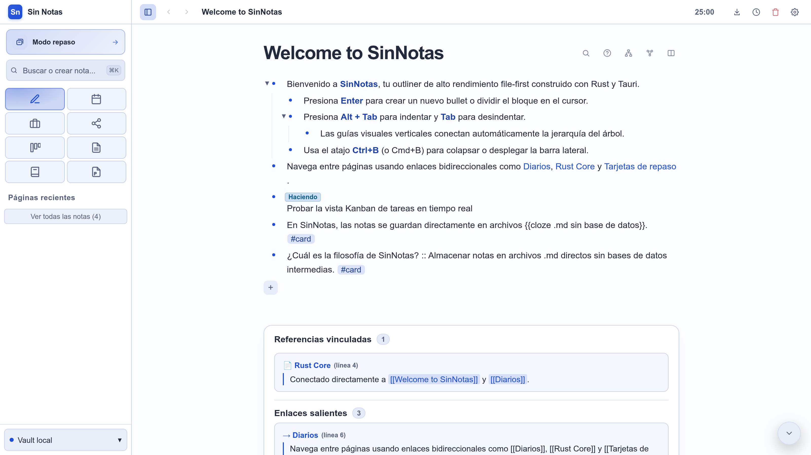
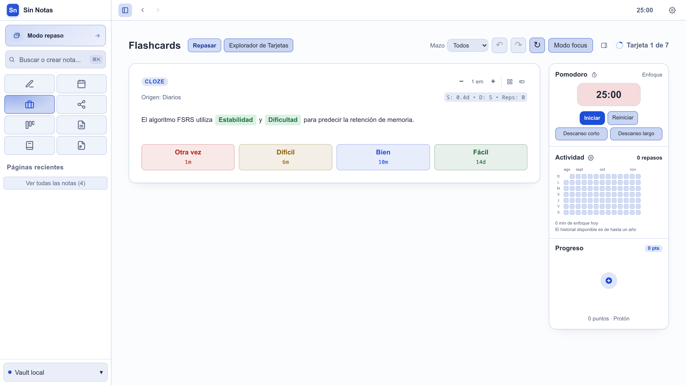
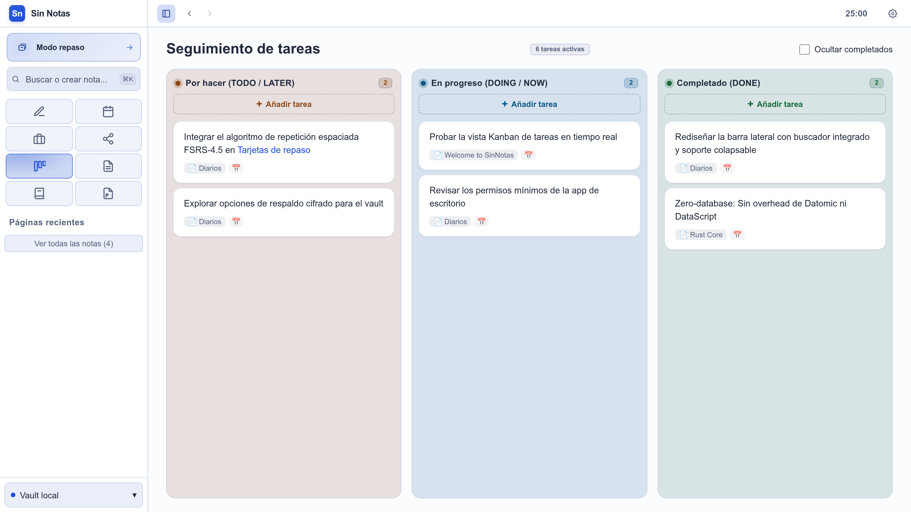
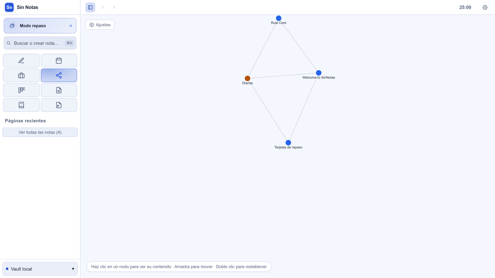
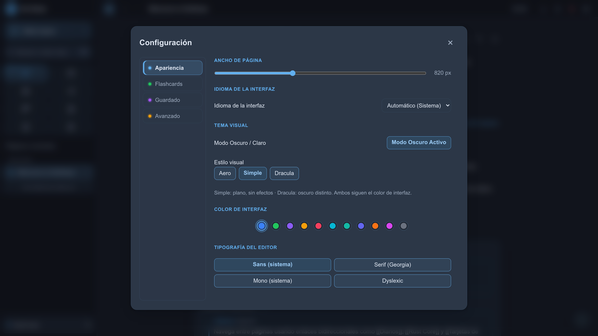

<div align="center">
  
  <h1>SinNotas</h1>
  <p><strong>Think in trees. Remember for years.</strong></p>
  <p>A local-first, file-based outliner for notes, tasks, PDFs and spaced repetition.</p>

  <p>
    <a href="https://github.com/wulflo/SinNotas/releases/tag/v0.5.7"></a>
    <a href="https://github.com/wulflo/SinNotas/actions/workflows/ci.yml"></a>
    
    
    
    
    
  </p>

  <p>
    <a href="#-why-sinnotas">Why SinNotas</a> ·
    <a href="#-features-in-detail">Features</a> ·
    <a href="#-screenshots">Screenshots</a> ·
    <a href="#-quick-start">Quick start</a> ·
    <a href="#-building-from-source">Build</a> ·
    <a href="CONTRIBUTING.md">Contributing</a> ·
    <a href="docs/SinNotas.md">Documentation</a>
  </p>
</div>

<picture>
  <source media="(prefers-color-scheme: dark)" srcset="docs/screenshots/editor-dark.png">
  
</picture>

> **Your notes are just Markdown files.** No database, no proprietary format, no cloud account required. Point SinNotas at a folder and your vault is ready.

---

## ✨ Why SinNotas?

| Pillar | What it gives you |
| :--- | :--- |
| **🗂️ Files, not silos** | Every page is a plain Markdown file inside your vault. Read, edit, grep, back up or sync it with any tool you already use. |
| **🧠 Built for learning** | FSRS-7 flashcards, Cloze cards, image occlusion, hierarchical decks, focus mode and a Pomodoro timer — inside the same place where you write. |
| **🔗 Connected thinking** | Wikilinks, backlinks and a custom force-directed graph turn isolated notes into a map of ideas. |
| **📄 One workspace** | Outliner, daily journals, tasks, PDF reader, bibliography and review queue live together, without plugins or a subscription. |
| **🔒 Local-first by default** | No telemetry, no account and no bundled cloud. Network access only happens when you explicitly ask for it. |
| **🎨 Yours to shape** | Light and dark themes, eleven accent colors, visual styles, system fonts and per-area typography controls. Available in Spanish, English and Chinese, with a repository shortcut in Settings. |

## 🚀 Features in detail

### ✍️ Outliner and writing

- **Hierarchical editor:** create and nest bullets, drag them to reorder, select multiple blocks and copy, cut, paste or delete them with their hierarchy. Siblings stay aligned even when some blocks carry properties.
- **Slash commands:** insert Markdown tables, H1–H6 headings, images, tasks and Cloze cards, or apply text and background colors.
- **Markdown rendering:** bold, italics, underline, highlight and wikilinks, with live inline formatting.
- **Inline tags:** `#tag` labels become a pill in the theme's accent color.
- **Tables:** stored as native Markdown, with graphical editing, a context menu for rows/columns and drag-and-drop reordering. Cloze text `==...==` also works inside cells.
- **Search:** `Ctrl/Cmd + F` searches inside the current note, highlights matches and lets you jump with `Enter`, `Shift + Enter` or the arrow keys.
- **Long-note navigation:** floating buttons jump to the start or end of tall notes and respect the real scroll position in both normal and split views.
- **Version history:** save and restore page snapshots. Snapshots live in `.sinnotas/chronos/`; legacy `chronos/` folders are migrated automatically.
- **Export:** export the current page as plain `.txt`.

### 📚 Organization

- **Journals:** create daily notes by date and browse them from the calendar.
- **All pages:** browse every note in the vault and open its version history.
- **External vaults:** open any Markdown folder through the directory picker and navigate its pages and subfolders.
- **Fast startup:** local vaults keep a persistent binary metadata cache (`.sinnotas_cache.bin`) so only new or modified notes are parsed on launch. A native filesystem watcher applies external edits incrementally.
- **Sync your way:** use any file-sync service you trust to keep notes up to date across devices. SinNotas does not impose a cloud provider.

### 🧠 Flashcards and spaced repetition

- **Card types:** basic, Cloze and image-occlusion cards, scheduled with FSRS-7.
- **FSRS-7 model:** the official 34-weight FSRS-7 scheduler from `ts-fsrs` 6.0.0, with a dual-trace memory state (stability plus fast stability) instead of an approximation. Desired retention, maximum interval, learning/relearning steps and weights are configurable **per deck**, and each deck schedules its notes with its own parameters.
- **Learning phase:** new cards pass through short fixed steps (1 min, 10 min) before graduating to FSRS review, avoiding misleading initial interval jumps. The learning state persists across reloads.
- **Review tools:** focus mode, Pomodoro timer, review statistics, a heatmap and a progress visualization that grows with your practice.
- **Batched recalculation:** *Settings → Recalculate properties* applies each note's deck parameters and yields between batches of 40 notes, saving page by page so large vaults stay responsive.
- **Hierarchical decks:** use `→` in note titles (for example `Mental health → Anxiety → Topic 1`) to nest decks. Select a parent deck to include all child notes, filter reviews from settings and keep the draft selection while searching or paging.
- **Image occlusion:** draw rectangles, ellipses and polygons, move, resize and rotate areas, add hints and store the transformations in the block's Markdown metadata.
- **Images:** supports PNG, JPG/JPEG, WebP, SVG, GIF and BMP. Inserted images are saved to the vault's `assets/` folder.

### 🔗 Graph and concept maps

- A custom force-directed physics model for navigating relationships between pages.
- Selection with alternating clicks, background click to clear, node dragging, panning with the middle/right button, wheel zoom and double-click to reset.
- Custom node colors propagate to neighbors by influence.
- Interaction stays alive indefinitely, even after the layout settles.
- See [docs/SinNotas.md#grafo-y-mapa-conceptual](docs/SinNotas.md#grafo-y-mapa-conceptual).

### 📄 Documents, PDFs and bibliography

- **Native PDF library:** the **Documents** section lists and renders PDFs with PDFium. No PDF.js and nothing downloaded at runtime.
- **Link, don't copy:** importing a PDF links the original file instead of duplicating it. Optional link expiry keeps the library tidy without touching the original. Linked documents can be removed from the library without deleting the source; PDFs stored in `assets/pdfs/` can be deleted from the vault.
- **Selectable text:** PDFium extracts text segments and the reader paints a transparent HTML layer over the page. Copy a selection or insert it as a bullet in the active note with the `pdf-source::` property.
- **Side-by-side editor:** show the PDF and the note in parallel with a draggable splitter, keyboard resizing, double-click reset and a remembered ratio.
- **Captures and occlusion:** drag a rectangle over a page to save it as a PNG in `assets/pdf-captures/`, insert it into the note and optionally open the occlusion editor.
- **Bibliography:** manage resources with `bib-*` frontmatter, local or validated remote covers and child notes linked through sanitized wikilinks. Search by DOI, ISBN-10/13 or keywords from the **Add resource** dialog.
- The native PDFium library lives in `src-tauri/resources/pdfium/<os>-<arch>/` and is fetched with `scripts/fetch-pdfium.sh`. Binaries are not committed.

### ✅ Tasks and planning

- **Kanban board:** pending, in progress and completed columns, drag-and-drop between columns and an option to hide completed tasks.
- **Daily notes:** add Kanban tasks to the daily journal and review them alongside your notes.
- **Pomodoro:** focus and break durations, long-break cadence, count-up mode, optional sound and a compact timer in the header.

### 🔐 Privacy and security

- **Local-first:** notes stay in your vault. There is no telemetry or analytics.
- **Clipboard sanitization:** pasted content goes through a whitelist pipeline (`src/editor/paste-sanitizer.ts`). Only indentation, bold, italic, underline, strikethrough, inline code and lists survive. Colors, font sizes, link attributes, event handlers and rich HTML are discarded.
- **Path validation:** desktop file operations are validated in the backend and limited to the active vault. `resolve_vault_path` rejects `..`, absolute paths outside the root, NUL bytes, symlinks escaping the vault and Android URIs. The folder picker uses `dialog:allow-open`; no global filesystem access is granted.
- **Review HTML safety:** card Markdown is escaped and sanitized with DOMPurify before any `innerHTML`, on desktop and Android. Occlusion regions are validated and drawn with `createElementNS`/`setAttribute`, never by interpolating user HTML.
- **Signed updates:** desktop packages are verified with the Tauri updater signature before installation.
- See [PRIVACY_POLICY.md](PRIVACY_POLICY.md) for the full privacy policy.

## 📸 Screenshots

| Flashcards | Kanban tasks |
| :---: | :---: |
|  |  |

| Graph / concept map | Appearance settings |
| :---: | :---: |
|  |  |

## ⚡ Quick start

### Requirements

- **Node.js 24 or newer** (required by `package.json` engines and CI).
- **Rust stable** with `rustup`.
- The platform webview and system packages. Linux dependencies are listed below; Windows and Android prerequisites are in their build sections.

<details>
<summary><strong>Linux dependencies by distribution</strong></summary>

**CachyOS, Arch Linux, Manjaro, EndeavourOS**

```bash
sudo pacman -S nodejs npm rust
```

**Debian, Ubuntu, Linux Mint, Zorin, Pop!_OS and derivatives**

```bash
sudo apt update
sudo apt install libwebkit2gtk-4.1-dev build-essential curl wget file \
  libxdo-dev libssl-dev libayatana-appindicator3-dev librsvg2-dev
```

> Debian and Ubuntu repositories often ship outdated Node and Rust versions. Install Node with [nvm](https://github.com/nvm-sh/nvm) or [NodeSource](https://github.com/nodesource/distributions), and Rust with `rustup`.

**Fedora, Nobara, RHEL and derivatives**

```bash
sudo dnf install webkit2gtk4.1-devel openssl-devel curl wget file \
  libappindicator-gtk3-devel librsvg2-devel libxdo-devel nodejs npm
sudo dnf group install "c-development"
```

**openSUSE (Tumbleweed and Leap)**

```bash
sudo zypper up
sudo zypper in webkit2gtk3-devel libopenssl-devel curl wget file \
  libappindicator3-1 librsvg-devel nodejs npm
sudo zypper in -t pattern devel_basis
```

</details>

### Run the web frontend

```bash
npm install
npm run dev
```

Vite prints the local address in the terminal. This mode is ideal for UI work; native features such as local vaults, PDFium and the updater require the Tauri app.

### Run the desktop app

Download PDFium once for the current platform, then start Tauri:

```bash
scripts/fetch-pdfium.sh
npm run tauri dev
```

PDFium is not committed to the repository. The release workflows fetch the matching library for Linux, Windows and both macOS architectures before packaging.

## ⌨️ Editor shortcuts

| Shortcut | Action |
| :--- | :--- |
| **Enter** | Split the block at the caret or create the next bullet. |
| **Shift + Enter** | Insert a line break inside the same block. |
| **Tab** / **Shift + Tab** | Indent or outdent the block (or the selected bullets). |
| **Alt + Right** / **Alt + Left** | Indent or outdent the selected bullets. |
| **Delete** / **Backspace** | Delete the selected bullets. |
| **Ctrl/Cmd + C** / **X** | Copy or cut the selected bullets when no text is selected. |
| **Ctrl/Cmd + V** | Paste through the sanitizer. Only safe Markdown formatting survives. |
| **Ctrl + Shift + V** | Paste as plain text. |
| **Ctrl/Cmd + Z** | Undo. **Ctrl/Cmd + Y** or **Ctrl/Cmd + Shift + Z** redoes. |
| **Ctrl/Cmd + B** | Collapse or expand the sidebar. |
| **Ctrl/Cmd + K** | Quick search and quick page creation (omnibar). |
| **Ctrl/Cmd + F** | Search inside the current note. `Enter` / `Shift + Enter` or the arrows move between matches; `Escape` closes the search. |
| **↑ / ↓** | Move the caret between blocks when it is at the start or end of the current block. |
| **? (Help button)** | Open the keyboard-shortcuts dialog from the editor header. |

The navigation, find-in-note, select-all and flashcard shortcuts can be changed in **Settings → Shortcuts**. A combination already assigned to another action (or reserved, such as Copy/Paste) is rejected; ↺ restores the default.

## 🧪 Tests and benchmarks

```bash
npm test              # unit test suite (Vitest)
npx tsc --noEmit      # TypeScript type checking
npm run build         # production frontend build
```

Backend tests and lints:

```bash
cargo test --manifest-path src-tauri/Cargo.toml --lib
cargo clippy --manifest-path src-tauri/Cargo.toml --all-targets -- -D warnings
```

Live test bench for the graph view (real interaction in a browser):

```bash
npm run dev
# open http://localhost:1420/graph-harness.html
```

The result appears on the page itself (`HARNESS PASS` expected, 17 gesture checks: selection, background, drag, pan, zoom, colors and stability after settle). After modifying the graph, both the test suite and the harness are mandatory; guidelines and the checklist live in [docs/SinNotas.md#grafo-y-mapa-conceptual](docs/SinNotas.md#grafo-y-mapa-conceptual).

### Metadata cache benchmark

Generate a 5,000-note temporary vault and compare a cold startup (full Markdown parse) with a warm startup (mtime sweep + bincode load):

```bash
scripts/benchmark-cache.sh
# or: cargo run --release --manifest-path src-tauri/Cargo.toml --example cache_benchmark -- 5000
```

The script prints cold/warm milliseconds and the speedup, then deletes the temporary vault. See [docs/SinNotas.md#cache-de-metadatos-y-watcher](docs/SinNotas.md#cache-de-metadatos-y-watcher) and the recorded results in [docs/BENCHMARK-2026-10-29.md](docs/BENCHMARK-2026-10-29.md).

## 🏗️ Building from source

### Build the AppImage (Linux)

```bash
scripts/fetch-pdfium.sh
npm run tauri -- build --bundles appimage
```

### Build the Snap and Flatpak (Linux)

Both packages wrap the same binary produced for the `.deb`:

```bash
scripts/package-linux.sh              # builds the .deb and extracts it
snapcraft pack                        # needs snapcraft + LXD
flatpak-builder --force-clean --repo=repo flatpak_app \
  packaging/flatpak/com.sinnotas.desktop.yml
```

CI builds both in `.github/workflows/package-linux.yml` and attaches the `.snap` and `.flatpak` to every GitHub release. They update through their stores, not through Tauri's updater: the app detects `SNAP`/`FLATPAK_ID` and hides the built-in update controls so users update from the store instead.

### Build on Windows

Prerequisites:

- [Node.js](https://nodejs.org/) (recommended with nvm-windows).
- [Rust](https://www.rust-lang.org/tools/install) with `rustup` (adds the MSVC target).
- [Microsoft C++ Build Tools](https://visualstudio.microsoft.com/visual-cpp-build-tools/) with **Desktop development with C++**.
- [WebView2](https://developer.microsoft.com/microsoft-edge/webview2/) (usually present on modern Windows 10/11).
- [Git for Windows](https://gitforwindows.org/) (Git Bash, needed by `scripts/fetch-pdfium.sh`).

From PowerShell or CMD in the project root:

```bash
npm install
bash scripts/fetch-pdfium.sh
npm run tauri build
```

This generates the `.msi` and/or `.exe` (NSIS) installer under `src-tauri/target/release/bundle/`. To compile without installers, use `npm run tauri build -- --no-bundle`.

For Windows development:

```bash
npm install
bash scripts/fetch-pdfium.sh
npm run tauri dev
```

Desktop file operations are validated in the backend and limited to the active vault. The folder picker uses the Tauri permission `dialog:allow-open`; no global filesystem access is granted.

### Build on macOS

Install the Xcode Command Line Tools and Rust with `rustup`, then run:

```bash
npm install
scripts/fetch-pdfium.sh
npm run tauri build
```

Tauri produces a `.app` and `.dmg` under `src-tauri/target/release/bundle/`. For a universal binary, add both Rust targets with `rustup target add aarch64-apple-darwin x86_64-apple-darwin` and build with `npm run tauri build -- --target universal-apple-darwin`. The release workflow fetches both PDFium architectures.

### Desktop updates on Linux

AppImage installs use the `linux-x86_64` entry in `latest.json`. Debian/Ubuntu installs use the signed `linux-x86_64-deb` entry from 0.2.2 onward, so the app can download and install the new `.deb` with `pkexec`/`sudo`. An existing 0.2.0/0.2.1 `.deb` install must install 0.2.2 manually once; later releases update from the app. See [docs/SinNotas.md#actualizador](docs/SinNotas.md#actualizador).

### Android application (review + full editor)

The APK targets Android 13 or newer (`minSdkVersion` 33) and opens in the review experience: question, answer, image occlusions, editing the active block and FSRS rating. From **Open pages and editor** it can load the full desktop editor, including journals, Kanban, concept map and graph view. Both surfaces respect the Android status and navigation bars through the native safe-area bridge.

On Android the vault is a real user folder selected through SAF. The first review launch without a saved vault opens the system directory picker; the app persists read/write access and keeps that root when switching to the full editor. Cancelling or losing the permission shows a central vault gate instead of silently loading the private `files` directory. The **Change vault** button uses the same picker.

Android updates are downloaded with the native HTTP plugin and saved through MediaStore in `Downloads/SinNotas/`, so any file manager can open the APK and hand it to the system installer. The app does not install the APK by itself.

The **Review notes** selector groups notes into a deck tree using `→` in their titles. It paginates visible root decks at 20 per page, lets you expand/collapse and tri-state select parent decks, and renders each page in small animation-frame batches. This keeps the modal responsive with thousands of notes; the draft selection is kept while moving between pages, searching or selecting parent decks, and searching returns to page 1.

```bash
# Local build (requires the Android SDK/NDK and the Rust targets)
npm ci
npm run tauri android init -- --ci
# `android init` regenerates gen/android, so reapply the native safe-area
# bridge that keeps the status/navigation bars from covering the app UI.
npm run android:patch
# `android init` creates the project with Tauri's default icons. The APK uses
# its own logo (`icons/icon-manifest.android.json`); this command regenerates
# only the Android assets and leaves the desktop icons untouched.
npm run android:icons
VITE_APP_MODE=flashcards npm run tauri android build -- --apk --debug --target aarch64
```

Android Studio is not required: the SDK command-line tools, platform/build-tools, NDK and a JDK 17+ are enough. Point `ANDROID_HOME` and `NDK_HOME` at the installed SDK and NDK before running the commands. The debug APK is written to `src-tauri/gen/android/app/build/outputs/apk/`; it is signed with the debug key, so it cannot update an APK signed with the release key (uninstall the release build first or install it with a different application ID).

If `src-tauri/gen/android` already contains an older safe-area patch, delete it before running `android init`; the patch script refuses to reuse the old version silently. This is only relevant for local builds: CI always regenerates the project from scratch.

The `.github/workflows/ci.yml` workflow builds the APK on pushes/PRs and a signed release APK on `master` or by `workflow_dispatch`; it publishes it as a downloadable artifact but never creates a release. Publishing happens only from a `v*` tag through `.github/workflows/release.yml`. Signing secrets are isolated in the `sign_apk` step. To load the secrets, test without publishing and verify the signature, see [docs/SinNotas.md#ci-y-publicación](docs/SinNotas.md#ci-y-publicación); the full update system is described in [docs/SinNotas.md#actualizador](docs/SinNotas.md#actualizador).

Launch modes:

- `VITE_APP_MODE=flashcards`: forces the review view in any build.
- `VITE_APP_MODE=desktop`: forces the full application.
- No variable: Tauri detects `TAURI_ENV_PLATFORM=android|ios` (or a mobile user agent) and opens the review view; on desktop it opens the full application.

The review build mounts the review app first; the desktop editor is a separate dynamic chunk that loads only when the user opens **Open pages and editor**. An empty SAF vault stays empty (sample notes are not injected into a user-selected folder), so FSRS, Cloze and occlusions can be tried from the existing notes or from a fresh internal vault when no SAF folder is chosen.

### Vault data and scoped storage

Inside any vault, app-managed data lives under `.sinnotas/`:

```text
<vault>/
├── *.md                        # notes: plain Markdown
├── assets/                     # images and PDF captures
└── .sinnotas/
    ├── chronos/                # page snapshots
    ├── progress/reviews.json   # review journal
    └── documents/links.json    # linked PDF documents
```

Legacy `chronos/` and `progress/` folders are migrated on load. Review progress keeps at most 4,000 events, 5 MB and 365 days of history, so the journal cannot grow without bound.

The backend only accepts real paths inside the active vault root. `resolve_vault_path` rejects `..`, absolute paths outside the root, NUL bytes, symlinks escaping the vault and Android URIs (`content://`, `file://`, `http://`, etc.). Android SAF folders are handled by the native `tauri-plugin-android-fs` storage backend (`SafStorage`), not by treating the scoped URI as a filesystem path, so access is limited to the tree the user authorized.

## 📚 Documentation

New to Sin Notas? Start with the end-user guide in your language:

- [Guía de uso](docs/GUIA-DE-USO.md) (español)
- [User guide](docs/USER-GUIDE.md) (English)

The technical guide [docs/SinNotas.md](docs/SinNotas.md) covers architecture, the editor and vault, FSRS/Learning mode, hierarchical decks and the paginated mobile notes selector, Android safe area, the desktop/Android updater, security, performance, build and CI/release steps, latest published release data and known limitations.

Additional checklists:

- [Release process](docs/RELEASE.md)
- [Consolidated checklist — PDF, security, bibliography, FSRS, decks, themes, UI, maintenance and performance](docs/CHECKLIST-CONSOLIDADO.md)
- [Android keystores](docs/KEYSTORES.md)

## 🤝 Contributing

Contributions are welcome! Read [CONTRIBUTING.md](CONTRIBUTING.md) for the full development setup, coding guidelines, test requirements and pull-request checklist.

The short version:

1. Open an issue before starting a large feature or refactor.
2. Fork the repository and create a focused branch.
3. Keep the stack simple: Tauri v2 + Rust + native TypeScript/HTML/CSS (no React or Tailwind).
4. Run `npm test`, `npx tsc --noEmit`, `npm run build`, `cargo test` and `cargo clippy` before opening a PR.
5. Never commit secrets, keystores or PDFium binaries.

## 📄 License

SinNotas is released under the [MIT License](LICENSE).

<div align="center">
  <sub>Built with Rust, Tauri and a stubborn preference for plain text.</sub>
</div>
